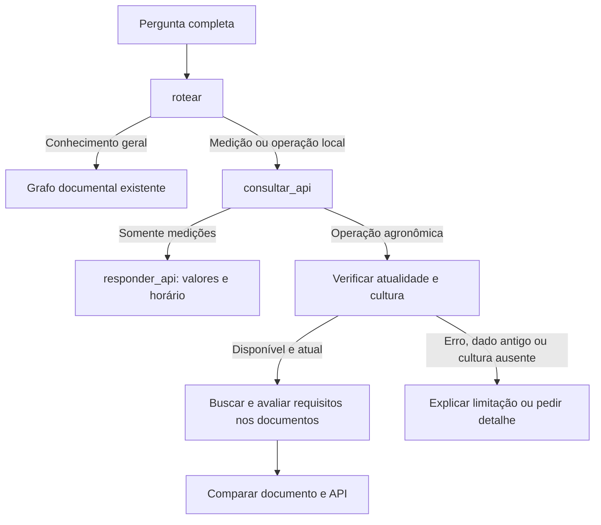

# API meteorológica simulada + documentos

O projeto agora consulta uma API HTTP feita com **JSON Server 0.17.4**, fixado no `api/package.json` e no lockfile. O servidor atende somente `127.0.0.1:3001`. Dados meteorológicos permanecem na API: não são inseridos no Chroma e não exigem nova ingestão.

## Correções da integração

- A umidade volumétrica do solo tem **uma única origem**: `planos_plantio.umidade_volumetrica_pct`. O campo antigo `medicoes.umidade_solo_pct` foi removido. Valores e horários existentes foram preservados; backup: `api/db.antes-correcao-umidade.json`.
- O chatbot não mostra mais a mensagem contraditória “não informada neste sensor”. Se o campo correto estiver ausente, informa a ausência sem inventar um valor.
- “Qual a umidade do solo hoje?” consulta o plano mesmo sem informar a cultura, desde que exista exatamente um plano aplicável. Vários planos exigem desambiguar o cadastro.
- Plano indisponível, solo antigo, dados faltantes, encharcamento, falta de trafegabilidade, umidade fora do intervalo de teste ou data fora da janela interrompem a análise combinada antes de gerar uma avaliação favorável.
- Perguntas gerais sobre condições ideais ou importância da umidade usam documentos; não são confundidas com leitura atual de sensores.
- A API recarrega `db.json` antes de atender após alterações externas. JSON inválido retorna HTTP 503; não serve silenciosamente o conteúdo antigo. PATCH continua sendo persistido.
- `/health` identifica o serviço `rag-fazenda-demo`, versão 2. `parar_api.bat` encerra somente um processo cujo comando contém o caminho absoluto do servidor deste projeto.

No PowerShell, use ` .\parar_api.bat` para encerrar e ` .\iniciar_api.bat` para iniciar. No chatbot use `/sair` e então ` .\iniciar_chatbot.bat` para carregar alterações Python. Não é necessário reiniciar a API apenas para editar valores no JSON.

Verificação das correções: 47 testes automatizados do Python e quatro testes HTTP isolados passaram. Para repetir os testes reais de recarga/persistência, execute `.\.venv312\Scripts\python.exe -m tests.verificar_api_http`. Eles usam um banco temporário, sem modificar `api/db.json`.

## Plano de plantio: solo, cultivar e janela (atualização de 13/10/2026)

O recurso `GET /planos_plantio?fazendaId=demo&cultura=soja` acrescenta os dados que faltavam. Reinicie a API e o chatbot para carregar esta atualização. O cadastro atual já foi criado; não é necessário executar novamente o seed. O arquivo anterior foi preservado em `api/db.antes-plano.json`.

| Campo | Exemplo fictício |
|---|---|
| Talhão | `talhao-demo-01` (vinculado à medição) |
| Solo | Textura argilosa; umidade **volumétrica** de 28% |
| Condições observadas | Não encharcado e trafegável |
| Horário da observação do solo | Registrado separadamente; validade de até seis horas no mesmo dia |
| Cultivar | `SOJA-DEMO-001 (fictícia)` |
| Ciclo cadastrado | 115 dias |
| Localidade | Cuiabá/MT |
| Janela fictícia | 01/10 a 30/11 do ano em que o seed for executado |
| Origem da janela | `SIMULACAO_NAO_ZARC` |
| Intervalo hídrico para testar o programa | 20–35% volumétricos, **inventado para teste**, sem validade agronômica |

Esses números são apenas dados e regras artificiais de um cenário de software. Não correspondem a cultivar real, recomendação de umidade ou janela oficial. A checagem do calendário usa a data atual de Cuiabá e inclui os dois dias extremos. Umidade volumétrica não significa porcentagem da capacidade de campo.

Agora o chatbot informa quais campos realmente faltam, quais observações estão antigas e quais regras fictícias não foram atendidas. Não repete a frase fixa de que faltam solo, cultivar e janela quando esses dados estão presentes. O cadastro precisa corresponder à fazenda, talhão, cultura e município. Se houver vários planos para a mesma cultura/fazenda, o protótipo pede resolução do cadastro em vez de escolher um talhão arbitrariamente.

Exemplos:

```text
Quais as condições climáticas hoje? Posso plantar soja?
Qual é a cultivar de soja da minha fazenda?
Qual é a janela de semeadura de soja da minha fazenda?
Como está a umidade do solo hoje para soja?
```

No cenário inicial, a resposta apresenta solo e calendário como compatíveis com as regras FICTÍCIAS do plano [PLANO], e relaciona as temperaturas com o documento [1]. A constatação não vira autorização para plantio real. A previsão do tempo e a validação oficial de cultivar/zoneamento continuam fora do escopo.

Para testar um cenário desfavorável, altere `encharcado` para `true`, `trafegavel` para `false`, umidade para fora do intervalo de teste ou a janela para fora da data atual. Use PATCH em `/planos_plantio/demo-soja`, ou edite `api/db.json` com o servidor parado. `null` nos campos de condição do solo representa informação ausente. O seed recria também este plano.

Implementação: `src/planting_context.py` valida o contrato e calcula condições; `WeatherClient.planting()` consulta o recurso; o grafo combina esse contexto com os documentos. 42 testes automatizados passaram, incluindo casos de solo antigo, dados ausentes, condições adversas, intervalo inválido, múltiplos planos e vínculos incorretos.

As descrições abaixo documentam também a primeira versão meteorológica; a falta do plano de plantio naquela versão foi resolvida pela atualização acima.

## Executar no computador atual

1. Abra `iniciar_api.bat` e mantenha a janela aberta.
2. Com o Ollama disponível, abra `iniciar_chatbot.bat`.
3. Ative `/fluxo` para acompanhar as etapas.

Se a API já estiver rodando, não inicie uma segunda cópia na mesma porta. Para encerrar, use Ctrl+C no terminal do servidor.

```text
/fluxo
Qual é a temperatura hoje da minha fazenda?
Quais as condições climáticas hoje? Posso plantar a soja?
Qual é a origem da soja?
```

O último exemplo continua consultando somente os documentos. Não há memória entre mensagens: informe cultura, operação e contexto na mesma pergunta. `/filtro soja` fornece uma cultura padrão; cultura explícita na pergunta combinada tem precedência.

## Dados de demonstração e atualização

O arquivo `api/db.json` contém `fazendas`, `medicoes` e `planos_plantio`. Os valores iniciais são **inventados para teste**: ar 28 °C, solo 25 °C, umidade do ar 68%, chuva acumulada 12 mm nas 24 horas anteriores à medição e vento 8 km/h. A umidade volumétrica do solo fica somente no plano do talhão, inicialmente 28%. Use `null` nesse campo para testar informação ausente. Não há previsão do tempo.

O horário é registrado quando `api/seed.cjs` é executado; não avança automaticamente. Para renovar a demonstração:

1. Encerre o servidor.
2. Execute `renovar_dados_demo.bat` (recria o JSON de demonstração, descartando suas alterações nesse arquivo).
3. Abra novamente `iniciar_api.bat`.

Para testar seus próprios valores, edite `api/db.json` com o servidor parado e reinicie. Datas precisam incluir fuso, por exemplo `2026-10-13T08:00:00-04:00`. A integração considera atual somente medição do mesmo dia em Cuiabá, com até seis horas de idade, sem horário futuro. Esse é um limite do protótipo, não uma norma agronômica. Dados antigos são mostrados com alerta e não fundamentam avaliação de uma operação hoje.

Também é possível alterar dados com PATCH enquanto o servidor está ativo, pois o JSON Server persiste as alterações. Exemplo PowerShell:

```powershell
$body = @{ temperatura_ar_c = 31; observado_em = [DateTimeOffset]::Now.ToString('o') } | ConvertTo-Json
Invoke-RestMethod -Method Patch -Uri http://127.0.0.1:3001/medicoes/demo-atual -ContentType application/json -Body $body
```

Isso continua sendo uma simulação; não cria uma medição real.

## Endpoints

| Requisição | Conteúdo |
|---|---|
| `GET /fazendas` | Fazendas cadastradas |
| `GET /fazendas/demo` | Fazenda configurada inicialmente |
| `GET /medicoes?fazendaId=demo` | Medições dessa fazenda |
| `GET /medicoes/demo-atual` | Medição de demonstração |

Exemplo de medição (horário ilustrativo):

```json
{
  "id": "demo-atual",
  "fazendaId": "demo",
  "observado_em": "2026-10-13T08:00:00-04:00",
  "simulado": true,
  "temperatura_ar_c": 28,
  "umidade_ar_pct": 68,
  "chuva_24h_mm": 12,
  "vento_kmh": 8,
  "temperatura_solo_c": 25
}
```

## Fluxo e responsabilidades



| Arquivo | Função |
|---|---|
| `api/package.json` e `pnpm-lock.yaml` | Dependência fixada e instalação reproduzível |
| `api/seed.cjs` | Cria medições fictícias com horário explícito |
| `api/server.cjs` | Inicia JSON Server e expõe recursos locais |
| `api/db.json` | Dados editáveis |
| `src/weather_api.py` | Faz GET com timeout de 3 s, valida unidades/faixa/horário/fazenda e escolhe a última medição |
| `src/assistant_graph.py` | Novo grafo externo: decide API/documentos/ambos e trata erros |
| `src/rag_graph.py` | Grafo documental preservado, com até duas buscas |
| `src/rag_engine.py` | Integra o grafo externo e compara medições com documentos aprovados |
| `src/chatbot_cli.py` | Exibe progresso, valores simulados, fontes e `/fluxo` |

O roteamento usa regras em português para evitar mais uma chamada ao modelo. É um escopo inicial, não compreensão irrestrita: reconhece termos meteorológicos, operação agronômica e contexto local/hoje. As medições vêm sempre da fazenda configurada, que é identificada na resposta. Nomes de fazendas escritos em linguagem natural não selecionam automaticamente outro cadastro.

Para consultas de plantio, a busca documental inicial procura condições de temperatura para semeadura da cultura. Quando o trecho aprovado explicita uma faixa no formato reconhecido, o Python extrai seus limites e compara os valores da API. Não há limites agronômicos fixados no código. Ar e solo são mostrados separadamente; o programa informa quando a passagem não distingue os dois. Outros formatos e operações utilizam a geração com modelo, que recebe os documentos e as medições e ainda pode errar. A análise atual não verifica automaticamente todos os requisitos hídricos ou a janela de semeadura.

## Exemplos observados em 13/10/2026

- **Temperatura hoje:** API → resposta com 28 °C simulados, identificação da fazenda e horário. Tempo observado: 0,13 s (sem chamada ao modelo para responder).
- **Posso plantar soja hoje?:** API → documentos → comparação. Encontrou página 46 do PDF de soja, com intervalo de 20–30 °C. Comparou 28 °C do ar e 25 °C do solo numericamente com esse intervalo e informou que o trecho não identifica explicitamente o meio da temperatura. Não autorizou plantio, pois faltam dados. Tempo observado: 3,73 s, com serviços já disponíveis.

Tempos são exemplos locais, não garantias. Registro completo: `tests/resultados_meteorologia.json`.

## Configuração e instalação em outra máquina

O Node disponível no computador atual foi utilizado para instalar as dependências locais. Os atalhos procuram `node` no PATH e têm fallback para o runtime local do Codex. Em outro computador, instale Node.js com npm e execute:

```powershell
cd api
npm install
npm start
```

Alternativa reproduzível com pnpm: `pnpm install --frozen-lockfile` e `pnpm start` dentro de `api`.

Antes de abrir o chatbot, configurações opcionais no mesmo terminal:

```powershell
$env:RAG_WEATHER_URL = 'http://127.0.0.1:3001'
$env:RAG_FARM_ID = 'demo'
.\.venv312\Scripts\python.exe chatbot_cli.py
```

A demonstração aceita fazendas no fuso `America/Cuiaba`. Outro ID deve existir na API e ter medições correspondentes. API indisponível, campos inválidos e ausência de medição geram mensagens claras, sem valores inventados. Falta de evidência documental impede a recomendação combinada. Histórico e previsão não estão implementados.

## Testar

```powershell
.\.venv312\Scripts\python.exe -m unittest discover -s tests -p 'test_*.py'
# Com API e Ollama ativos:
.\.venv312\Scripts\python.exe -m tests.executar_exemplos_meteorologia
```

37 testes automatizados passaram, incluindo roteamento, comparação dos limites extraídos, API sem resposta, dados inválidos/antigos/futuros, virada de dia em Cuiabá, fazenda incorreta, cultura ausente e falta de documentos. O teste real usa HTTP JSON Server + Chroma + Ollama.

Referência da ferramenta: [documentação oficial do JSON Server 0.17.4](https://github.com/typicode/json-server/tree/v0.17.4).
