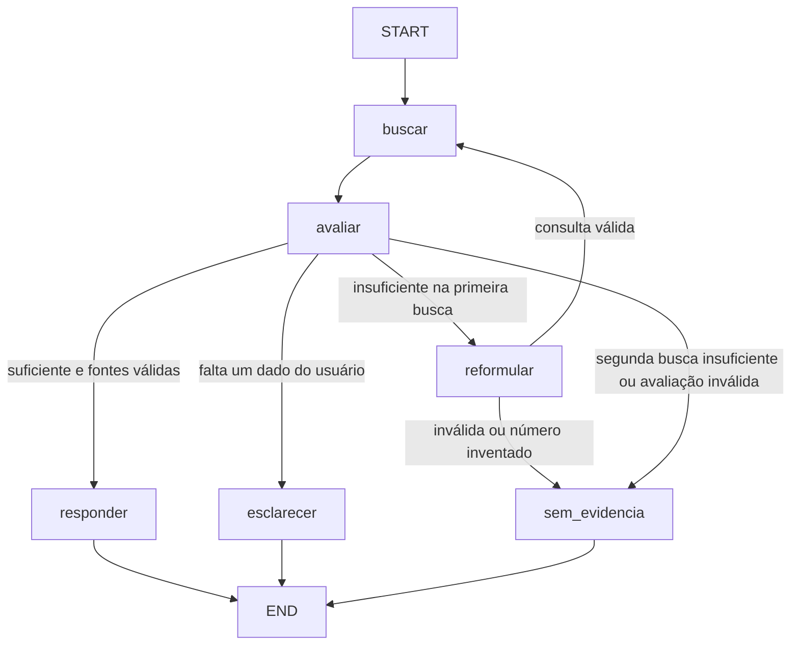

# LangGraph no protótipo: implementação e exemplos

## O que mudou

Antes, `stream_answer()` sempre seguia buscar → montar contexto → gerar, quando havia documentos. Agora ela executa um `StateGraph` compilado, definido em `src/rag_graph.py`. O grafo avalia os resultados e escolhe responder, pedir esclarecimento, tentar uma segunda busca ou reconhecer a insuficiência.

Os PDFs, a coleção Chroma e os modelos continuam sendo utilizados. Nenhuma nova ingestão é necessária para usar o grafo. As falhas de atualização da base registradas na revisão anterior continuam sendo um trabalho separado.



## Responsabilidade de cada arquivo

| Arquivo | Responsabilidade |
|---|---|
| `src/rag_graph.py` | Define os dados da consulta, seis nós, caminhos condicionais e máximo de duas buscas |
| `src/rag_engine.py` | Implementa as operações concretas: Chroma, avaliação estruturada, reformulação e geração com Ollama |
| `src/chatbot_cli.py` | Mostra progresso, recebe fontes/texto e permite observar o percurso com `/fluxo` |
| `requirements.txt` | Declara LangGraph explicitamente |
| `tests/test_rag_graph.py` | Verifica os caminhos do grafo real com operações controladas |
| `tests/executar_exemplos_langgraph.py` | Executa perguntas reais e grava respostas, percursos e tempos |

LangChain continua fornecendo `Document`, `ChatOllama`, a integração Chroma e os prompts. LangGraph decide a ordem em que essas operações são chamadas.

## Estado: o que acompanha uma consulta

Exemplo simplificado antes da primeira busca:

```python
{
    "original_question": "Qual é a origem da soja?",
    "search_query": "Qual é a origem da soja?",
    "culture_filter": "soja",
    "k": 4,
    "attempts": 0,
    "documents": [],
    "approved_documents": [],
    "assessment": None,
    "error": "",
    "answer": "",
    "outcome": ""
}
```

`documents` guarda os candidatos da busca atual. `approved_documents` guarda os trechos indicados pelo avaliador como evidência para a resposta. Uma nova busca substitui os candidatos anteriores. `attempts` aumenta em cada busca. `original_question` permanece intacta mesmo quando a consulta de busca muda.

O estado é novo a cada chamada. Não há checkpointer nem armazenamento de histórico. Se o chatbot pedir um detalhe, o usuário deve enviar uma pergunta completa com esse detalhe na próxima mensagem.

## Os seis nós

### 1. buscar

Entrada: consulta de busca, `k` e filtro. Usa `retrieve()` do mecanismo existente.

Saída: documentos recuperados e contador incrementado. O filtro não é escolhido nem alterado pelo modelo.

### 2. avaliar

Entrada: pergunta original, filtro e textos dos candidatos. Usa o Llama pelo Ollama com temperatura zero e formato JSON estruturado, validado por Pydantic.

Antes de consultar o avaliador, uma regra explícita identifica pedidos curtos como “Como controlar essa doença?” ou “Como tratar essa praga na soja?”, que não identificam o problema. Como não há histórico de conversa, esses pedidos seguem diretamente para esclarecimento. Essa regra cobre referências simples; outras ambiguidades continuam dependendo do avaliador.

Exemplo didático de saída:

```json
{
  "decision": "sufficient",
  "evidence_ids": [1],
  "reason": "A fonte 1 responde diretamente à pergunta.",
  "clarification": ""
}
```

As decisões possíveis são `sufficient`, `insufficient` e `clarify`. Para responder, a lista de fontes deve ser não vazia e seus números precisam existir nos candidatos. Saída inválida encerra a consulta com uma mensagem de falha de avaliação. Um erro de conexão continua sendo apresentado como erro técnico; ele não é convertido em alegação de ausência de informação.

Antes dessa decisão chegar ao grafo, o modelo retorna `CompactAssessment`: decisão, `evidence_quotes` e esclarecimento. O Python deriva os IDs das fontes dessas passagens; o modelo não precisa gerar IDs duplicados nem justificativas longas. São permitidas até duas passagens de 20 a 300 caracteres, com instrução para copiar apenas cerca de 80 caracteres pertinentes. O mecanismo confere se cada passagem aparece naquela fonte, tolerando espaços, caixa, acentos e palavras divididas por hífen na extração do PDF. Não usa similaridade aproximada; alterações em números ou remoção de negações continuam sendo rejeitadas. Fontes sem passagem confirmada são descartadas; se nenhuma permanecer, a avaliação vira insuficiente. Essa checagem confirma correspondência textual normalizada, não relevância nem veracidade da resposta final. Perguntas que exigem muitas evidências podem precisar ser divididas.

As chamadas ao Ollama usam uma janela de contexto de 4.096 tokens, instruções compactas e os quatro trechos usuais. Documentos maiores ou alterações na quantidade de trechos exigem reavaliar esse limite. O avaliador/reformulador pode gerar até 400 tokens; respostas estruturadas incompletas continuam sendo rejeitadas. O modelo de linguagem permanece carregado por até 15 minutos após o uso, sujeito à disponibilidade de memória e ao gerenciamento do Ollama.

Se a busca não trouxe documento algum, a avaliação é marcada como insuficiente sem chamar o modelo.

### 3. reformular

Entrada: pergunta original, consulta anterior e filtro. Solicita uma consulta alternativa ao modelo, com preservação de assunto, cultura, local e tempo.

Exemplo didático:

```text
Pergunta original: Qual é a origem da soja?
Expansão sugerida: origem geográfica e domesticação da soja
Nova busca:
  Qual é a origem da soja?
  Termos de busca: origem geográfica e domesticação da soja
```

A busca é ancorada na pergunta original. Uma expansão vazia, idêntica à consulta anterior ou com números ausentes da pergunta original é rejeitada. Isso impede, por exemplo, que o modelo transforme “hoje” em um ano inventado. Ainda é possível haver expansão semântica inadequada; a avaliação seguinte considera novamente a pergunta original.

Só existe uma reformulação e, no máximo, duas buscas por consulta. Depois da segunda avaliação, o fluxo não volta a reformular. Também há um limite técnico de passos como proteção adicional.

### 4. responder

Entrada: pergunta original e documentos selecionados. Usa o Llama para produzir a resposta em streaming. As instruções ficam na mensagem de sistema; os documentos são entregues como evidências, com orientação para ignorar instruções contidas neles.

As fontes selecionadas recebem IDs `[1]`, `[2]`, etc. A tabela da interface preserva essa numeração, mesmo quando dois trechos vêm da mesma página. O código verifica IDs selecionados pelo avaliador; não faz uma checagem semântica completa de todas as citações escritas pelo gerador.

### 5. esclarecer

Entrada: uma decisão `clarify` e uma pergunta de esclarecimento não vazia.

Exemplo didático:

```text
Usuário: Como controlar essa doença?
Chatbot: Qual cultura e qual doença você quer abordar?
Envie a pergunta completa incluindo esse detalhe para uma nova consulta.
```

Esse nó encerra a execução atual. Não gera uma recomendação técnica e não mantém uma conversa suspensa no grafo.

### 6. sem_evidencia

Encerra quando duas buscas não oferecem evidência suficiente, quando a avaliação é inválida ou quando não foi possível obter uma reformulação válida. Cada condição tem sua própria mensagem. Não conclui que a informação inexiste em todos os documentos apenas porque a busca falhou.

## Comunicação com o terminal

O grafo usa eventos personalizados do LangGraph:

```python
{"type": "step", "node": "buscar", "attempt": 0, "search_number": 1}
{"type": "sources", "docs": [...]}  # evidências selecionadas
{"type": "token", "content": "Fragmento da resposta"}
```

O exemplo de evento foi abreviado. `step` atualiza o progresso; `sources` prepara a tabela; `token` mostra o texto. A saída estruturada do avaliador não é apresentada como resposta ao usuário.

## Como experimentar

Reinicie o chatbot com o comando habitual, na raiz:

```powershell
.\.venv312\Scripts\python.exe chatbot_cli.py
```

Dentro dele:

```text
/fluxo
/fontes
/filtro soja
Qual é a origem da soja?
Qual é o preço da soja hoje em Cuiabá?
/filtro off
Como controlar essa doença?
```

Os caminhos esperados são resposta, reconhecimento de informação ausente e esclarecimento. O modelo pode variar; os resultados reais da execução de validação ficam em `tests/resultados_langgraph.json`.

## Validação e limites

Na execução inicial de 12/10/2026, os 23 testes automatizados passaram. A execução com Chroma e Ollama produziu estes resultados históricos, preservados em `tests/resultados_langgraph_antes_otimizacao.json` (tempos de uma execução, não um benchmark):

| Pergunta | Caminho observado | Resultado | Tempo |
|---|---|---|---|
| Qual é a origem da soja? | buscar → avaliar → responder | Ásia, mais provavelmente nordeste da China | 50,29 s |
| Qual é o preço da soja hoje em Cuiabá? | buscar → avaliar → reformular → buscar → avaliar → sem_evidencia | Reconheceu evidência insuficiente | 16,99 s |
| Como controlar essa doença? | buscar → avaliar → esclarecer | Solicitou o problema e a cultura | 0,14 s |

Os três caminhos esperados passaram naquela execução inicial. Isso não significa que todos os aspectos das respostas estivessem corretos: na primeira pergunta, o avaliador manteve também um trecho de composição da soja desnecessário para a resposta e sua justificativa confundiu fontes. O gerador respondeu corretamente sobre a origem, mas omitiu os marcadores de citação solicitados e preservou uma palavra hifenizada do PDF. A tabela de fontes continua disponível.

### Otimização de 13/10/2026

Foram validados 25 testes automatizados e novamente os três percursos reais. Com modelos já carregados, os tempos finais foram:

| Pergunta | Tempo | Resultado |
|---|---|---|
| Origem da soja | 5,58 s | Respondeu Ásia/nordeste da China, selecionando apenas a página 19 |
| Preço da soja hoje em Cuiabá | 5,37 s | Duas buscas e reconhecimento de evidência insuficiente |
| Como controlar essa doença? | 0,07 s | Pediu identificação da cultura e problema |

Na pergunta sobre origem, busca levou aproximadamente 0,29 s, avaliação 3,23 s e geração 2,05 s. A medição anterior do diagnóstico foi 4,38 s, 34,09 s e 3,09 s, respectivamente (41,57 s no total). As condições de carregamento e cache não foram controladas entre essas medições: não se trata de benchmark nem garantia de ganho para qualquer pergunta. A primeira pergunta após abrir o Ollama ou após descarregar os modelos pode demorar mais.

O uso observado do modelo mudou de 32% CPU/68% GPU com contexto 8.192 para 22% CPU/78% GPU com contexto 4.096. Não houve alteração global do Ollama ou remoção das verificações do grafo. Resultados finais: `tests/resultados_langgraph.json` e `tests/resultados_langgraph_aquecido.json`. Um teste intermediário que respondeu incorretamente foi preservado em `tests/diagnostico_otimizacao_intermediaria.json`; ele não representa a versão final. A conferência da resposta além do caminho do grafo foi essencial para detectar essa regressão.

O teste final ainda omitiu o marcador de citação no texto, embora a tabela contenha a fonte correta. A amostra é pequena: precisão agronômica e citações exigem revisão mais ampla.

Os testes automatizados usam o LangGraph instalado e executam seus nós e arestas, com substitutos apenas para banco e modelos. Cobrem sucesso na primeira busca, sucesso após reformulação, limite de buscas, esclarecimento, banco sem candidatos, IDs inválidos, formato inválido, reformulação inválida, números inventados, falha de infraestrutura, fontes selecionadas e isolamento entre consultas.

Também há testes da interface `/fluxo`, numeração de fontes, atribuição incorreta de passagens, passagens inventadas e quebra de palavras dos PDFs. Execute todos com:

```powershell
.\.venv312\Scripts\python.exe -m unittest discover -s tests -p 'test_*.py' -v
```

Os exemplos reais verificam integração com Ollama e Chroma. Não medem precisão agronômica em uma amostra ampla. O avaliador usa o mesmo modelo de 3 bilhões de parâmetros que gera as respostas: ele pode rejeitar evidência útil ou aprovar evidência inadequada. Saída estruturada garante formato validável, não verdade factual.

A avaliação acrescenta chamadas ao modelo; uma reformulação acrescenta ainda mais trabalho. O fluxo pode ficar mais lento. Para comparar qualidade, é necessário um conjunto de perguntas revisadas e respostas esperadas, além da avaliação de citações.

Referências consultadas: [Graph API](https://docs.langchain.com/oss/python/langgraph/graph-api) e [integração ChatOllama](https://docs.langchain.com/oss/python/integrations/chat/ollama).
