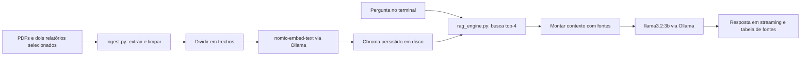

# Análise do protótipo RAG agronômico

Nota de organização: esta análise registra a revisão anterior à reorganização. Os arquivos de implementação citados estão agora em `src/`; as linhas referem-se à versão revisada. A reprodução está em [tests/verificar_ingestao.py](../../tests/verificar_ingestao.py). O erro posterior de caminho com acentos foi corrigido configurando a base externa; as falhas de ingestão descritas aqui continuam pendentes.

Data: 12/10/2026. Escopo: arquivos recebidos em `drive-download-20261012T142134Z-1-001`.

**Conclusão:** o código implementa um RAG linear adequado como ponto de partida para estudo e experimentação supervisionada. Há uma base preenchida, extração de PDFs, busca vetorial, geração local e apresentação das fontes. A confiabilidade das respostas ainda não foi demonstrada. A ingestão tem uma falha reproduzida que deve ser corrigida antes de atualizar ou reconstruir a base.

Esta análise não modificou os códigos recebidos nem a base vetorial. Os arquivos nesta pasta são material da revisão.

## 1. O que foi verificado

| Verificação | Resultado e limite |
|---|---|
| Leitura dos três arquivos Python e scripts de inicialização | Fluxo e configurações identificados |
| Análise sintática dos três arquivos Python | Sem erros de sintaxe; não equivale a executar o aplicativo |
| Consulta direta ao SQLite em modo somente leitura | 3.868 registros, metadados e origem dos trechos conferidos |
| `PRAGMA quick_check` | `ok`; não comprova integridade do índice vetorial HNSW nem compatibilidade com outra versão de Chroma |
| Inventário dos PDFs | Sete PDFs disponíveis; seis representados na base |
| Amostra de extração e conteúdo indexado | Há conteúdo preliminar de publicação indexado, incluindo folha de rosto e ficha catalográfica; não foi auditada a fidelidade de todas as tabelas e páginas |
| Simulação da ingestão | Falhas de atualização e retomada reproduzidas com a função original, banco e serviços simulados |
| Respostas reais do modelo | Não verificadas: as bibliotecas de execução não estão no Python usado para análise; a tentativa de consultar o Ollama local foi impedida por restrição de acesso ao socket |

Não foram instaladas dependências nem baixados modelos. A restrição de acesso ao Ollama não prova que o serviço esteja desligado. Não há resultado medido de precisão, tempo de resposta ou qualidade semântica nesta revisão.

## 2. Como o protótipo funciona

| Arquivo | Papel |
|---|---|
| `ingest.py` | Seleciona arquivos de uma lista fixa, extrai texto por página, limpa, divide e grava no Chroma |
| `rag_engine.py` | Recupera trechos, monta o prompt e chama o modelo de resposta |
| `chatbot_cli.py` | Interface de terminal, filtro de cultura e visualização das fontes |
| `requirements.txt` | Dependências Python com versões mínimas, sem ambiente reproduzível fixado |
| Scripts `.bat` | Instalação de pacotes, download de modelos e inicialização |

Configurações efetivamente usadas: coleção `embrapa_conhecimento`; embeddings `nomic-embed-text`; resposta `llama3.2:3b`; temperatura 0,2; quatro trechos por consulta; limite de 750 caracteres por trecho e sobreposição alvo de 120 caracteres. O banco registra dimensão vetorial 768. A configuração do código informa qual modelo se pretende usar, mas o banco não registra um identificador verificável da versão exata desse modelo.

O tamanho é em **caracteres, não tokens**, pois o splitter é usado sem tokenizador ou função alternativa de comprimento. Referência: [documentação oficial do splitter](https://docs.langchain.com/oss/python/integrations/splitters/recursive_text_splitter).

**LangChain é usado; LangGraph não faz parte da execução.** Não há grafo, avaliação de relevância ou reformulação automática de consultas nos arquivos Python. Esses elementos aparecem como estudo e pseudocódigo nos documentos Markdown. Isso não impede que o protótipo seja RAG: recuperar antes de gerar já constitui o fluxo básico.

## 3. O que está realmente na base

Contagem obtida dos metadados do SQLite, não apenas do README:

| Origem | Trechos |
|---|---:|
| 500 perguntas — Soja | 695 |
| 500 perguntas — Arroz | 613 |
| 500 perguntas — Milho | 884 |
| 500 perguntas — Hortaliças | 488 |
| 500 perguntas — Pós-colheita de hortaliças | 610 |
| 50 hortaliças — Comprar, conservar e consumir | 528 |
| Estudo LMCT-2919 | 19 |
| Relatório técnico Sprint 45 | 31 |
| **Total** | **3.868** |

São 3.818 trechos de seis PDFs e 50 de dois documentos técnicos sobre IA. O PDF `MANUAL-DE-PRODUCAO-DE-HORTALICAS-TRADICIONAIS.pdf` está na pasta, mas não consta no catálogo fixo de ingestão nem nas origens do banco.

Todos os registros têm texto e os campos `source`, `titulo`, `cultura`, `pagina` e `total_paginas`. Não há metadados de ano, edição, região, hash de arquivo ou versão de processamento. A faixa observada de tamanho dos textos é 39–750 caracteres, média aproximada de 594,8.

## 4. Achados por prioridade

P1 significa corrigir antes de confiar na operação afetada. P2 significa corrigir na próxima etapa de validação.

### P1 — A retomada por contagem pode omitir e duplicar conteúdo

Local: `ingest.py`, linhas 184–219, especialmente 186–193.

O script compara o total de registros com o total de trechos atuais e usa `chunks[current_count:]`. Isso pressupõe que os registros existentes correspondem exatamente ao início da lista atual. O código não verifica essa condição, não fixa IDs por conteúdo e não ordena explicitamente a seleção dos arquivos.

Dois problemas foram reproduzidos:

1. Um documento muda, mas o número de trechos fica igual. O script anuncia que tudo já foi indexado e mantém o conteúdo antigo.
2. Em 120 itens simulados, o primeiro lote de 40 falha e os dois seguintes são gravados. Na retomada, a contagem 80 faz o script inserir novamente os últimos 40. O resultado tem 120 registros, mas apenas 80 itens distintos: 40 ausentes e 40 duplicados.

**Correção proposta:** usar IDs determinísticos associados a documento, versão e trecho; registrar um manifesto; processar IDs ausentes; atualizar/remover versões substituídas. Para o piloto, reconstruir em uma coleção nova e validá-la antes de substituir a anterior também é uma alternativa. Não apagar a base atual para tentar compensar essa falha sem preservar uma cópia.

### P1 — Falhas definitivas ainda terminam com mensagem de sucesso

Local: `ingest.py`, linhas 210–223.

Depois de quatro falhas em um lote, o script mostra o erro, avança o progresso e continua. Ao final, imprime `[OK] Ingestão concluída!` independentemente dos lotes ausentes. A causa original da exceção também não é apresentada. A simulação confirmou a mensagem de sucesso com apenas 80 dos 120 itens gravados.

**Correção proposta:** contabilizar falhas, guardar a causa e os IDs afetados, produzir estado final de sucesso apenas após conferir os itens esperados e retornar erro para execução incompleta.

### P2 — Arquivo novo pode ficar invisível ao chatbot

Local: `ingest.py`, linhas 33–66 e 140–143.

Só entram arquivos cujos nomes aparecem em `DOC_METADATA_MAP`. Copiar um PDF para a pasta não o inclui automaticamente. O manual de hortaliças tradicionais demonstra o efeito no pacote recebido.

**Correção proposta:** manter catálogo explícito com situação de cada arquivo e informar PDFs não cadastrados. A lista de inclusão pode ser intencional; o problema é a falta de indicação clara para quem prepara a base.

### P2 — O filtro de hortaliças exclui materiais pertinentes e aceita erros de digitação

Local: `ingest.py`, linhas 46–56; `rag_engine.py`, linhas 69–73; `chatbot_cli.py`, linhas 107–115.

O filtro faz igualdade exata. `hortalicas` seleciona 488 trechos, deixando de fora 528 classificados como `hortalicas-guia` e 610 como `pos-colheita`. Isso ocorre porque o campo mistura cultura, tema e tipo de publicação. Além disso, digitar `hortaliças` com acento ou uma categoria inexistente é aceito pela interface, mas não corresponde às categorias armazenadas.

**Correção proposta:** separar cultura, tema e tipo de documento; normalizar entradas; validar opções; usar um agrupamento explícito para o filtro geral de hortaliças.

### P2 — Lista não vazia de resultados é tratada como evidência suficiente

Local: `rag_engine.py`, linhas 65–74 e 97–118.

O retriever é configurado apenas com `k` e filtro. O único bloqueio antes da geração é `if not docs`. Não há avaliação de se os resultados contêm a resposta, nem verificação de compatibilidade com a situação perguntada. O prompt pede que o modelo reconheça a ausência de informação, mas isso não é uma validação programática.

**Efeito possível:** perguntas fora do escopo ou sem resposta na base ainda podem gerar texto a partir de trechos apenas próximos em assunto. A ocorrência de resposta inventada precisa ser medida com o modelo real; não foi demonstrada nesta revisão.

**Correção proposta:** criar perguntas negativas e ambíguas, medir a recuperação e implementar uma decisão de suficiência. Se usar um limiar de distância/similaridade, calibrá-lo para esse índice; não tratá-lo como probabilidade universal de correção. A documentação distingue busca simples e busca com score: [integração Chroma](https://docs.langchain.com/oss/python/integrations/vectorstores/chroma).

### P2 — Numeração das fontes pode mudar entre o prompt e a interface

Local: `rag_engine.py`, linhas 82–88; `chatbot_cli.py`, linhas 144–155.

O prompt numera todos os trechos; a tabela final elimina repetições de título/página e renumera. Se os trechos 1 e 2 vierem da mesma página e o trecho 3 de outra publicação, o modelo verá a outra publicação como fonte 3, mas a tabela a exibirá como fonte 2. Se o modelo usar os identificadores do contexto, o usuário não conseguirá conciliá-los com a tabela.

**Correção proposta:** atribuir IDs estáveis às evidências e preservá-los na resposta e na apresentação. A lista de documentos recuperados também não prova que cada afirmação esteja sustentada por eles; falta avaliar essa relação.

## 5. Limitações importantes para seus testes

- **Sem memória de conversa:** cada chamada usa apenas a pergunta atual e os trechos recuperados. Depois de perguntar sobre soja, “e na época da colheita?” não recebe automaticamente o contexto anterior. O filtro permanece, mas não é histórico de conversa. Referências: `chatbot_cli.py:124` e `rag_engine.py:115–118`.
- **Divisão por página e por tamanho:** não há preservação explícita de cada par pergunta/resposta. Uma resposta que atravessa páginas permanece dividida, independentemente da sobreposição dentro de cada página. Avaliar isso é especialmente importante nos livros de 500 perguntas.
- **Extração limitada a texto:** `pypdf.extract_text()` não implementa OCR ou reconstrução explícita de tabelas neste programa. Páginas com menos de 50 caracteres são descartadas. O código não produz um relatório de páginas descartadas ou suspeitas.
- **Páginas são posições no PDF:** `pagina = page_idx + 1` não garante correspondência com a numeração impressa. A interface deveria informar “página do PDF” ou armazenar ambas.
- **Material de IA misturado à base agronômica:** isso é permitido pelo prompt do protótipo, mas deve ser separado se o chatbot final atender apenas dúvidas agronômicas. A tabela atual chama todas as fontes de “Embrapa”, incluindo relatórios do projeto.
- **Contexto dentro da mensagem de sistema:** os trechos entram junto às instruções, sem separação explícita de conteúdo não confiável. Na evolução, delimitar documentos como evidências e testar se instruções contidas neles alteram o comportamento esperado.
- **Sem avaliação persistida:** não foram encontrados testes automatizados ou resultados de um conjunto de perguntas com evidências esperadas. Exibir fontes e usar temperatura baixa não demonstram precisão factual.
- **Instalação não reproduzível:** requisitos com `>=` permitem ambientes diferentes, e o instalador usa `pip` sem criar ambiente virtual. Registrar versões efetivamente testadas e usar `python -m pip` no ambiente do projeto.
- **Download pode anunciar sucesso após erro:** `2_baixar_modelos_ollama.bat:24–32` não verifica o retorno de cada download. Adicionar verificações antes de anunciar conclusão.
- **Inicialização não comprova prontidão:** existência da pasta e construção dos objetos não substituem checagem da coleção e disponibilidade dos dois modelos. A interface anuncia conexão antes da primeira consulta real.

## 6. Documentação e implementação divergem

O estudo LMCT-2919 apresenta HuggingFace, embeddings de 384 dimensões, top-5, LangGraph e FastAPI em exemplos ou propostas. A implementação recebida usa Ollama para embeddings, a coleção registra 768 dimensões, o terminal pede top-4 e não existe API ou grafo executável.

Os exemplos do estudo não devem ser copiados sobre a base existente sem compatibilizar o modelo de embeddings e reconstruir o índice quando necessário. O texto também não deve ser lido como evidência de recursos já implementados. O README descreve operação local/offline, mas instalação e download dos modelos precisam de acesso aos recursos correspondentes antes do uso offline.

## 7. Sequência recomendada

1. Preservar o pacote original e corrigir atualização/retomada e sinalização de falhas.
2. Definir o catálogo de fontes, incluir ou excluir explicitamente o manual adicional e separar relatórios sobre IA.
3. Revisar metadados, filtros e amostras de extração, especialmente tabelas e respostas que atravessam páginas.
4. Testar somente a busca com perguntas e evidências esperadas antes de avaliar a geração.
5. Testar respostas com fontes corretas, fora de escopo, sem evidência e perguntas de acompanhamento. Registrar fidelidade, citações, tempo e falhas.
6. Considerar LangGraph quando houver necessidade concreta de pedir contexto, avaliar documentos, refazer a busca ou encaminhar para revisão. Ele não corrige sozinho uma base incompleta ou uma busca ruim.

Para estudar o código, a ordem mais clara é `ingest.py` → `rag_engine.py` → `chatbot_cli.py`. Em cada etapa, observe respectivamente o texto produzido, os trechos encontrados e a resposta final. Isso permite localizar se a falha começou na preparação, na recuperação ou na geração.

## 8. Reprodução da falha principal

O arquivo `verificar_ingestao.py`, nesta pasta, extrai e executa a função original `run_ingestion` com dependências simuladas. Não importa o aplicativo, não abre Chroma para escrita, não acessa modelos e não altera PDFs.

Resultado confirmado: uma alteração com a mesma contagem fica ignorada; um lote inicial perdido seguido de retomada produz 120 registros, 80 itens distintos, 40 ausentes e 40 duplicados. Esse resultado demonstra o defeito do algoritmo. Não significa que a base enviada já esteja nesse estado.
